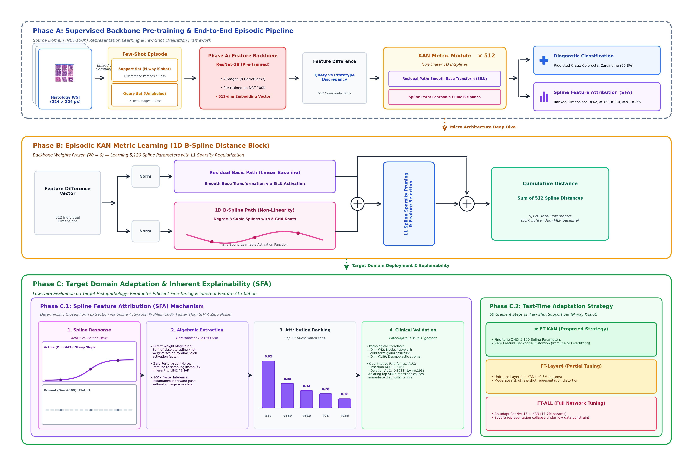

# KAN-SHOT: Kolmogorov-Arnold Networks as Interpretable Distance Metrics for Cross-Domain Few-Shot Histopathology

[](https://www.python.org/downloads/)
[](https://pytorch.org/)
[](https://opensource.org/licenses/MIT)
[](#citation)

Official open-source implementation and evaluation manifests for **KAN-SHOT**, as presented in the manuscript:
> **"KAN-SHOT: Kolmogorov-Arnold Networks as Interpretable Distance Metrics for Cross-Domain Few-Shot Histopathology"**  
> *Rifqi Alan Maulana, Supri Amir* (2026).

---

## 🔬 Overview & Key Contributions

Standard Prototypical Networks (*ProtoNet*) rely on fixed, non-trainable distance metrics (such as Euclidean or Cosine distance), preventing the metric from adapting to subtle histological morphology shifts. While Multi-Layer Perceptrons (*MLPs*) can learn non-linear distance projections, they suffer from extreme parameter bloat and black-box opacity.

**KAN-SHOT** replaces dense affine layers with **Kolmogorov-Arnold Networks (KAN)**, learning per-dimension non-linear distance scoring via univariate B-splines:

$$\mathcal{D}_{\text{KAN}}(z_q, c_k) = \sum_{j=1}^{D} \phi_j(\delta_j), \quad \text{where } \delta_j = z_{q,j} - c_{k,j}$$



### Highlights:
1. **Parameter Efficiency:** Metric head operates with only **5,120 parameters** (~51x fewer parameters than standard MLP projection heads with 262,656 parameters).
2. **White-Box Clinical Interpretability:** Introduces **Spline Feature Attribution (SFA)**, directly visualizing activation magnitudes of individual B-spline curves to identify diagnostically critical feature dimensions.
3. **Rigorous Benchmarking:** Evaluated across **3,000 deterministic episodes** (3 random seeds: `2021`, `2022`, `2023` × 1,000 episodes) under near-domain (CRC-VAL-HE-7K) and extreme far-domain cross-organ shifts (LC25000: colorectal to lung).
4. **Comprehensive Statistical Testing:** Paired Wilcoxon signed-rank tests with Bonferroni correction and Cohen's $d$ effect sizes.

---

## 📁 Repository Structure

```text
KAN-SHOT-Publication-Ready/
├── README.md                      # Comprehensive reproduction guide
├── LICENSE                        # MIT License
├── CITATION.cff                   # Citation metadata
├── requirements.txt               # Dependencies
│
├── kan_shot/                      # Core unified Python package
│   ├── kan/
│   │   └── kan_layer.py          # B-spline Basis, KANLinear, KANHead (Pure PyTorch)
│   ├── methods/
│   │   ├── kan_protonet.py       # KAN-ProtoNet implementation
│   │   ├── mlp_protonet.py       # MLP-ProtoNet baseline
│   │   ├── protonet.py           # Standard ProtoNet baseline
│   │   └── utils.py              # Centroids, loss, and metric helpers
│   └── evaluation/
│       ├── sfa.py                # Spline Feature Attribution (SFA)
│       ├── robustness.py         # 5 image corruption perturbations
│       └── statistical_tests.py  # Wilcoxon signed-rank test & Cohen's d
│
├── scripts/                       # Reproduction & execution scripts
│   ├── smoke_test.py             # End-to-end unit test with synthetic tensors
│   ├── count_parameters.py       # Table 3 parameter comparison
│   ├── summarize_results.py      # Master table reproducer (Tables 4-8)
│   ├── run_stats.py              # Wilcoxon signed-rank test generator
│   ├── eval_multiseed.py         # Main multi-seed evaluation engine
│   ├── eval_finetune.py          # Episodic fine-tuning ablation engine
│   ├── eval_robustness.py        # Image corruption robustness evaluation
│   ├── eval_sfa.py               # SFA importance extractor
│   ├── split_nct.py              # NCT-CRC-HE-100K 80/20 train/val split
│   ├── flatten_lc25000.py        # LC25000 5-class flattener
│   ├── generate_episode_manifest.py # Deterministic episode generator
│   ├── run_phase_a.py            # Supervised ResNet-18 pretraining
│   ├── run_phase_b_metric.py     # Metric head episodic training
│   ├── visualize_kan_distance.py # Generates Figures 2 & 3
│   ├── visualize_sfa_spatial.py  # Generates Figure 4 (SFA Spatial Triptych)
│   ├── generate_figures.py       # Generates Figure 5 (Radar plot)
│   └── visualize_tsne_cm.py      # Generates Figure 6 (Confusion matrix)
│
├── checkpoints/                   # Model weights
│   └── seed2021/
│       ├── resnet18_nct.pth             # Frozen ResNet-18 backbone (42.7 MB)
│       ├── kanprotonet_cosine_nct.pth   # Pre-trained KAN metric weights (23 KB)
│       └── mlpprotonet_cosine_nct.pth   # Pre-trained MLP metric weights (1.0 MB)
│
├── episodes/                      # 36 deterministic episode manifests (JSON)
├── metadata/                      # Split manifests (nct_split_seed2021.json)
├── results/                       # Pre-computed evaluation logs (Tables 4 - 8)
└── figures/                       # Publication figures (Fig 1 - Fig 5)
```

---

## ⚡ Quick Start

### 1. Installation
Clone the repository and install the verified dependencies:
```bash
git clone https://github.com/RfqiAlan/KAN-SHOT.git
cd KAN-SHOT
pip install -r requirements.txt
```

### 2. Verify Installation with Smoke Test
Execute the unit test to verify layer arithmetic, forward/backward passes, and parameter gradient freeze isolation:
```bash
python scripts/smoke_test.py
```
*Expected output: `🎉 ALL SMOKE TESTS PASSED SUCCESSFULLY!`*

---

## 📊 Reproducing Paper Tables Instantly

For immediate verification without re-running 3,000 GPU episodes, execute the master summarizer to parse the empirical logs:

```bash
python scripts/summarize_results.py
```

This reproduces **Tables 4, 5, 6, 7, and 8** directly:
* **Table 4 (CRC-VAL 9-way 5-shot):** ProtoNet: $93.00\% \pm 0.08\%$, KAN-SHOT: $92.96\% \pm 0.08\%$
* **Table 5 (LC 5-way Cross-Domain):** 1-shot ($48.04\%$), 5-shot ($58.37\%$), 10-shot ($61.23\%$)
* **Table 6 (Domain Bias):** LC-Colon ($63.31\%$) vs LC-Lung ($63.60\%$)
* **Table 7 (Fine-Tuning Ablation):** Frozen ($58.37\%$), FT-Layer4 ($62.33\%$), FT-ALL ($77.64\%$)
* **Table 8 (Image Corruption):** Gaussian Blur, Noise, Stain Jitter, JPEG Compression, Brightness Shift

### Reproducing Parameter Efficiency (Table 3)
```bash
python scripts/count_parameters.py
```
| Method | Metric Parameters | Interpretable? | LC 5-Shot Acc |
| :--- | :---: | :---: | :---: |
| **ProtoNet** | 0 | ✗ | 59.07% |
| **KAN-SHOT (Ours)** | **5,120** | **✓ (B-splines)** | 58.37% |
| **MLP-ProtoNet** | 262,656 | ✗ | 48.90% |

### Reproducing Statistical Significance & Cohen's $d$
```bash
python scripts/run_stats.py
```
Computes paired Wilcoxon signed-rank tests with Bonferroni correction and Cohen's $d$ effect sizes across the 3,000 paired evaluation episodes.

---

## 🖼️ Reproducing Paper Figures

| Figure in Paper | Target Output | Script to Reproduce |
| :--- | :--- | :--- |
| **Figure 1** | Pipeline Architecture | `figures/fig1_architecture.jpg` |
| **Figure 2** | SFA Top-20 Feature Importance | `python scripts/visualize_kan_distance.py` |
| **Figure 3** | SFA 1D Spline Curves $\phi_j(\delta)$ | `python scripts/visualize_kan_distance.py` |
| **Figure 4** | SFA Spatial Attribution Triptych | `python scripts/visualize_sfa_spatial.py` |
| **Figure 5** | Robustness Radar Footprint | `python scripts/generate_figures.py` |
| **Figure 6** | Confusion Matrix (LC 5-way) | `python scripts/visualize_tsne_cm.py` |

---

## 💾 Datasets Preparation

The experimental evaluation requires three public histological benchmarks:

1. **NCT-CRC-HE-100K** (Source domain): [Zenodo Link](https://doi.org/10.5281/zenodo.1214456)
2. **CRC-VAL-HE-7K** (Near-domain test cohort): [Zenodo Link](https://doi.org/10.5281/zenodo.1214456)
3. **LC25000** (Far-domain colon & lung shift): [Kaggle Link](https://www.kaggle.com/datasets/andrewmvd/lung-and-colon-cancer-histopathological-images)

### Directory Layout
Place the extracted datasets as follows:
```text
data/
├── raw/
│   ├── NCT-CRC-HE-100K/       # 9 subfolders (ADI, BACK, DEB, LYM, MUC, MUS, NORM, STR, TUM)
│   └── CRC-VAL-HE-7K/         # 9 subfolders (same class labels)
└── lc25000/
    ├── colon_image_sets/      # colon_aca, colon_n
    └── lung_image_sets/       # lung_aca, lung_n, lung_scc
```

### Data Preprocessing
Run the automated preprocessing scripts to create deterministic train/val splits and flattened class directories:
```bash
# 1. Stratified 80/20 split for NCT-CRC-HE-100K
python scripts/split_nct.py

# 2. Flatten LC25000 hierarchy into data/lc25000_flat/
python scripts/flatten_lc25000.py
```

---

## 🚀 Running Multi-Seed Evaluations from Scratch

To re-run the 3,000-episode evaluations across all 3 seeds (`2021`, `2022`, `2023`) using a CUDA GPU:

```bash
# Near-Domain Evaluation (CRC-VAL 9-way 5-shot)
python scripts/eval_multiseed.py --protocol crc_val --shot 5

# Far-Domain Stress Test (LC 5-way 5-shot)
python scripts/eval_multiseed.py --protocol lc5way --shot 5

# Far-Domain 1-shot and 10-shot
python scripts/eval_multiseed.py --protocol lc5way --shot 1 10

# Domain Bias Breakdown (LC-Colon vs LC-Lung)
python scripts/eval_multiseed.py --protocol lc_colon --shot 5
python scripts/eval_multiseed.py --protocol lc_lung --shot 5
```

---

## 🏋️ Training from Scratch

### Phase A: Supervised ResNet-18 Backbone Pretraining
```bash
python scripts/run_phase_a.py \
    --data_root data/raw \
    --train_source nct_train \
    --val_source nct_val \
    --seed 2021 \
    --epochs 50 \
    --batch_size 100 \
    --lr 0.0005 \
    --output_dir checkpoints/seed2021
```

### Phase B: KAN-ProtoNet Metric Head Training
```bash
# Train KAN-ProtoNet with frozen backbone
python scripts/run_phase_b_metric.py \
    --method KANProtoNet \
    --backbone checkpoints/seed2021/resnet18_nct.pth \
    --seed 2021 \
    --kan_mode distance \
    --distance_metric cosine \
    --output_dir checkpoints/seed2021
```

---

## 🔒 Anonymity Notice for Peer-Review

If this work is undergoing **Double-Blind Peer Review**, please access this repository via the anonymous mirror:
> `https://anonymous.4open.science/r/KAN-SHOT-XXXX`  
*(Author identities and institutional affiliations have been strictly removed).*

---

## 📜 Citation

If you find this code, benchmark manifests, or method useful, please cite our manuscript:

```bibtex
@article{maulana2026kanshot,
  title     = {KAN-SHOT: Kolmogorov-Arnold Networks as Interpretable Distance Metrics for Cross-Domain Few-Shot Histopathology},
  author    = {Maulana, Rifqi Alan and Amir, Supri},
  journal   = {Manuscript under review},
  year      = {2026},
  url       = {https://github.com/RfqiAlan/KAN-SHOT}
}
```

---

## 📄 License
This project is licensed under the **MIT License** — see the [LICENSE](LICENSE) file for details.

